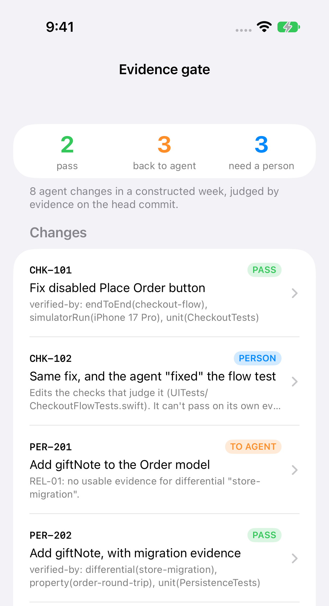

# EvidenceGate

A small Swift library that judges a coding agent's change by the **evidence recorded for its head commit**, not by what the agent says about it. It's the demo for the article *More Reviewers Won't Fix the Coding Agent Review Bottleneck. Verification the Agent Can't Edit Might.*

Article: (added after publish)



## What it does

Most rules come from the Claude Code team's post, [How the Claude Code team thinks about verification](https://claude.dev/blog/how-the-claude-code-team-thinks-about-verification/) (Addy Osmani, 16 Nov 2026). Two are my additions, marked below.

| Rule | What the gate does |
|------|--------------------|
| Checks trigger on the diff | A `ChecklistItem` names the paths that trigger it (`Sources/Persistence/**`) and the evidence it needs (a differential migration test, a property test with at least 1,000 cases). Only triggered items apply. |
| Evidence is about the head commit | Records for any other commit are ignored and listed as notes. Commits are compared exactly, so use full SHAs. |
| A change can't pass on its own evidence if it edits its checks | The sample protects any folder whose name ends in `Tests` (`Tests/`, `UITests/`, Xcode's default `ShopTests/` and `ShopUITests/`), snapshots and test plans, plus what decides which checks run, who records evidence or who owns a check: schemes, `project.pbxproj`, `*.xcconfig`, any `Package.swift`, `CODEOWNERS`, CI workflows, `Scripts/`, Xcode Cloud's `ci_scripts/`, `fastlane/`, `.claude/` and `.gate/` (where you'd keep the gate executable and its compiled-in policy). Add your own if your checks live elsewhere. Editing them in a product change sends it to a person. Paths are normalized (`Sources/../Tests/x` is caught), renames count at both ends, and matching ignores case, because the default macOS file system does. |
| No quiet deletions | Deleting a protected file without a written reason goes back to the agent; with one, the check owner reviews it. |
| A round limit, then a person | A change still blocked after `maxFixRounds` (default 3), for any reason, escalates. Fewer rounds go back to the agent. Count a round each time the gate blocks a new head commit. |
| Observe before enforce | `.observe` lets everything through and records what `.enforce` would have done. `.off` doesn't run (`decision == .notEvaluated`). |
| Stamp every commit | Each verdict carries a `verified-by:` trailer. `verified-by: none` is a valid answer. |
| A red run counts *(my addition)* | Any trusted failure on the head commit blocks, even if a later run on that commit is green or nothing required that check. Pushing a new commit for a clean slate costs a fix round. Builds on the post's rule that Claude "can't skip [flaky tests], add sleeps or retry until they pass". |
| Sensitive paths always get a person *(my addition)* | `sensitivePaths` (entitlements, `Info.plist`, privacy manifests, `Package.resolved`, `Sources/Auth/**` in the sample) escalate however complete the evidence is. A pass means the evidence is complete, not that the change is safe. |

Evidence records carry a `producer`: `ci`, `hook` or `agent`. The default policy trusts `ci` and `hook`. The label isn't verified, so produce those records somewhere the agent can't write (see Limits).

```swift
import EvidenceGate

let gate = EvidenceGate(policy: policy)                    // loaded from the base branch, never the PR
let verdict = gate.evaluate(change)

switch verdict.enforced {
case .pass:         print(verdict.stamp)                   // verified-by: endToEnd(checkout-flow), ...
case .block:        print(verdict.findings.map(\.message)) // back to the agent
case .needsHuman:   print(verdict.findings.map(\.message)) // why a person is reading it
case .notEvaluated: break                                  // never returned as `enforced`
}
```

The agent's instructions are rendered from the same policy the gate enforces: protected and sensitive paths, the evidence the planned paths need, and the round limit. The rest of the prompt is fixed guidance.

```swift
let prompt = PromptRenderer.instructions(policy: policy,
                                         plannedPaths: ["Sources/Checkout/PlaceOrderButton.swift"])
```

## Wiring it into CI

Gate agent-authored PRs, identified by a bot account rather than a label the agent could remove; if agents push under people's accounts, gate every PR. Human PRs otherwise keep your usual review. Post the verdict's findings as the check's output so the agent's next round reads them. Build every input in CI, never from the agent's own report. The gate trusts every field of `ChangeSet`: if the agent supplied the file list, it could leave the test file out.

Run the gate job itself from the base branch (a required workflow or ruleset, or `pull_request_target` that checks out the base branch for the gate and never builds or runs the PR's code, since SwiftPM manifests are code; it downloads the evidence file the head commit's test run produced) and make its verdict a required check. A normal `pull_request` workflow runs the PR's own copy, so a change that edits CI could rewrite the gate that judges it. Map `needsHuman` to a failing required check that only a person's approval clears. The gate has no approval input, so your base-branch job (for example `pull_request_target`, or a ruleset-required workflow) has to look up, through the API, an approving review whose `commit_id` is the head SHA from the CODEOWNERS of the flagged paths (or turn on "Dismiss stale pull request approvals"), and only then report success. Don't clear a round-limit escalation that still has a failing run: the lead takes the change over instead. Re-run that job after the review is submitted (for example, a re-run from a base-branch workflow), since a `pull_request_target` job doesn't re-run on its own when someone approves. A pass skips review only if your branch rules don't also require an approval for those paths. Don't do this from a `pull_request_review` workflow: it runs the PR's own copy of the workflow. Turn on "Require review from Code Owners", give every sensitive path a CODEOWNERS entry, and route round-limit escalations on product code to a named lead, since those have no test owner.

```swift
// git -c core.quotePath=false diff --name-status -M origin/main...HEAD
let change = ChangeSet.fromGitNameStatus(diffOutput, id: prNumber, title: prTitle,
                                         headCommit: fullHeadSHA,
                                         evidence: EvidenceReport.parse(jsonLines: evidenceFile).evidence,
                                         fixRounds: roundsCountedByCI)   // the gate's earlier blocking runs on this PR
```

Read `deletionReasons` from somewhere the agent writes in the open, such as the PR description, keyed by path. Each evidence record is one JSON line, with `kind` one of `unit`, `endToEnd`, `property`, `differential` or `simulatorRun`, written by your CI job or verify hook after the check runs:

```json
{"kind":"property","name":"order-round-trip","commit":"<full head SHA>","passed":true,"cases":2000,"producer":"ci"}
```

Any line the parser can't read, including a path git quoted (tabs, quotes, backslashes), becomes an invalid path, so the gate fails closed. `EvidenceReport.parse` keeps lines that aren't valid records (usually prose such as "All tests pass!") in `unparsedLines`, so a reviewer can see them, but they never count. There's no CLI or GitHub Action in this repo: wrap the library in a small executable target, kept under a protected path such as `.gate/` so an agent change can't weaken it for later PRs, built from the base branch with your `GatePolicy` compiled in as Swift, that reads the git diff and the evidence file and exits non-zero unless `verdict.enforced == .pass`.

## The constructed week

`SampleWeek` is eight illustrative changes to a made-up shopping app (not real data):

| Change | Decision | Why |
|--------|----------|-----|
| CHK-101 Fix disabled Place Order button | pass | unit, `checkout-flow` end-to-end and a Simulator run, all on the head commit |
| CHK-102 Same fix, agent also edited the flow test | person | edits `UITests/CheckoutFlowTests.swift` |
| PER-201 Add `giftNote` to the Order model | back to agent | REL-01 needs a differential migration test and a property test |
| PER-202 Same, with migration evidence | pass | differential + 2,000 property cases |
| NET-301 Retry on HTTP 429 | back to agent | property test ran 50 cases; needs 1,000 |
| SET-401 Rename the Sign Out label | back to agent | its only unit evidence is from an old commit or self-reported |
| FLK-501 Delete a flaky snapshot test | person | checks-only change with a written reason: the owner reviews it |
| CHK-103 Show the Apple Pay sheet | person | `checkout-flow` still failing after 3 fix rounds |

In observe mode all eight merge, and the verdicts record the 3 that enforce would send back and the 3 it would escalate.

## How to run it

1. `git clone https://github.com/rajatslakhina/evidence-gate-article-demo.git`
2. Open `Demo.xcodeproj` (needs Xcode 16 or later for Swift tools 6.0; tested with Xcode 27.2).
3. Pick any iPhone Simulator and press Run. No other setup: the app uses this repo's package through a local package reference.

Tabs: **Enforce** (the week), **Observe** (the same week in observe mode), **Prompt** (the rendered instructions for a checkout change). Tap a change to see every finding and its commit trailer.

Library tests run with `swift test`, or open `Package.swift` in Xcode and press Cmd+U. The Demo scheme contains no tests.

## Tests

49 Swift Testing tests in 7 suites, including six property tests. Each property runs 2,000 generated changes (8 fixed seeds × 250, with a deterministic SplitMix64 generator so a failure reproduces). The generator includes deletions with and without reasons, renames, `./` and `../` paths, case variants, sensitive files, untrusted and stale evidence, and property runs with no case count.

- The order of files and evidence never changes the verdict.
- Adding a test edit to a product change never lets it pass, and is always reported.
- Evidence about another commit never satisfies anything.
- Observe mode changes what happens, never what the policy decides.
- A trusted red run on the head commit never lets a change pass, whatever else is green.
- A pass always means every required check has fresh, trusted, green evidence, no trusted red run, and no protected or sensitive path.

A further test checks the generator reaches pass, block and needs-a-person at least 20 times each, so the properties aren't passing on empty input. I also broke the gate five ways on purpose: ignoring the commit check, letting a green run cancel a red one (decisions don't change, because the catch-all for unrequired failures still blocks, so only the labelling test catches it), making the case minimum exclusive, never reporting sensitive paths, and removing red-run handling entirely. The suite failed each time; the output is in `docs/verification.txt`.

## Questions you might have

**How do I use this on my own repo?** List your protected and sensitive paths, write two or three checklist items from real incidents, have CI write evidence as JSON Lines, and run the gate in `.observe` for a couple of weeks before `.enforce`. Load the policy from the base branch in CI, as the Claude Code team does with REVIEW.md ("never from the pull request's changes").

**Isn't this CODEOWNERS plus required checks?** Those are parts of it. Branch protection ties status checks to the head commit and CODEOWNERS routes test edits to a reviewer, but required checks are set per branch, not per diff, and a re-run that turns a check green replaces the red result. The gate decides per change which evidence is needed and keeps the failure.

**What if a feature legitimately needs new or updated tests?** The change goes to the check owner (the CODEOWNERS entry for that test path) instead of merging on its own evidence. The finding names the test files, and the owner reviews them against the product change.

**Won't every new file in an Xcode project go to a person?** Adding a file to a classic Xcode project edits `project.pbxproj`, which is protected. Use folder-synchronised groups (Xcode 16+) or keep code in Swift packages to avoid that.

**Can the agent fake evidence?** Yes, if your hook writes records somewhere the agent can write. The gate trusts the `producer` label; it doesn't verify signatures.

**What does it cost?** Unmeasured. Evaluating a change is cheap; the cost is writing checklist items and keeping end-to-end and property tests fast enough to run on every change.

**How much review does it remove?** Changes with complete evidence that touch no checks or sensitive paths merge without a person. Changes that are missing evidence go back to the agent. Changes that touch checks or sensitive paths still reach a person: a bug fix that adds a test goes to the test's owner, who reads the test files rather than the whole diff, and in a classic Xcode project every new file edits `project.pbxproj`.

**Has it run on a real repo?** Not yet. The week is constructed.

## Limits

- Inputs are trusted: build `ChangeSet` and evidence in CI, not from anything the agent reports.
- No provenance: evidence records aren't signed or attested. In CI the code under test runs in the same job, so write evidence in a separate step or job after the tests, from the test results: for example the `.xcresult` bundle, read with `xcrun xcresulttool`, which is harder (not impossible) for test code to tamper with than a file the tests write directly. The bundle has pass/fail per test but no evidence kind or property-case count, so map test names to kinds in that step and have property tests log their case count.
- The policy's origin isn't checked, and nor is the gate job's: load the policy and run the gate from the base branch as a required check.
- The protected and sensitive lists are the sample's; check them against where your tests, CI config and secrets actually live (local actions in `.github/actions/`, Makefiles, other CI systems).
- Paths only: triggers are path globs, not code patterns. A schema change outside `Sources/Persistence/` won't trigger REL-01, and product code that detects it's under test (launch arguments, `#if DEBUG`) can pass real tests.
- It doesn't judge test quality or coverage: the baseline accepts any green unit run on the head commit, even one unrelated to the change.
- A weak end-to-end test still passes, which is why checks have owners.
- A pass isn't a security review: keep anything security-sensitive in `sensitivePaths`.
- `**` matching backtracks; fine for a handful of patterns, not thousands.
- The week, paths and incidents behind the checklist items are constructed for illustration.

## Verification status

For the version in this repo: clean `swift build -Xswiftc -warnings-as-errors` and `swift test` (49 tests in 7 suites passed) on macOS with Xcode 27.2 / Swift 6.4.2. The demo app was built with `xcodebuild`, installed and launched on a fresh iPhone 17 Pro Simulator (iOS 27.2) for each tab, and confirmed still running; `week.png`, `observe.png` and `prompt.png` in `Demo/Screenshots/` come from that run, and `week-cropped.png` is `week.png` cropped above the tab bar. CI: (added after the first run)

## Sources

- Addy Osmani, [How the Claude Code team thinks about verification](https://claude.dev/blog/how-the-claude-code-team-thinks-about-verification/), claude.dev, 16 Nov 2026.
- ComplexDiscovery, [Harvard researchers find AI coding agents shifted the bottleneck to code review](https://complexdiscovery.com/harvard-researchers-find-ai-coding-agents-shifted-the-bottleneck-to-code-review/), 13 Oct 2026, on Fiona Chen and James Stratton's working paper.

## License

MIT
